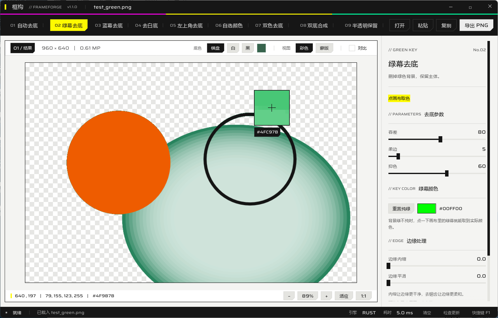

# 框构 // 智能抠图处理

> 变体卡（endfield-ui）：`standard` · 强调色 `#FFFA00` · 纸 `#F4F4F2` · 切角 small/button · 无圆角 · 深色标题栏 + 深色模式命令栏 · 动效 0.10–0.15s

FrameForge / frameronin「抠图去背」的 **Rust 原生独立版**。单文件 exe，双击即用，不联网。
半透明算法移植自 frameronin 线上版（逆向其前端 bundle 的 `wt` 函数）；色键/双背景对照其开源仓库。
智能去底内核为本项目自研的「底色场 + 逐点反解」（说明见 `tools/algo-notes.md`）。


[仓库](https://github.com/118coder/kuanggou) · [最新版本](https://github.com/118coder/kuanggou/releases/latest)



## 使用

双击 `框构.exe`。载入图片：**拖进窗口直接替换主图**（双底合成模式先拖两张自动填槽）/ `Ctrl+V` / 顶部「打开」/ 命令行
`框构.exe 图片.png [模式] [底色]`，模式 `auto|green|blue|white|corner|custom|dual|dualbg|fx`，底色 `white|black|green|blue|magenta`。

## 两个工作区

顶部工作区条切「01 图片抠图 / 02 视频 / GIF」，也可按 `W` 切换。两边素材与参数各自独立，切回来原样保留。

## 图片模式：十种（顶部深色命令栏，数字键 1–9 / `0`）

| 模式 | 说明 |
|---|---|
| **自动去底** | 自动找图片边缘最常见的颜色当背景并反解前景；不准时点画布取色 |
| **绿幕去底 / 蓝幕去底** | 删掉绿/蓝背景；**键色可选**：纯绿/纯蓝一键复位，或点画布取实际颜色（不纯的绿也能抠） |
| **去白底** | 从四边往里泛洪，只清外围白底 |
| **左上角去底** | 只删和左上角连着的背景；主体内部的同色部分不动（不会把主体掏空） |
| **自选颜色 / 双色去底** | 点画布取色，删一种或同时删两种颜色 |
| **双底合成** | 同一主体拍黑底、白底各一张，合成出真实透明 |
| **半透明保留** | 彩色光效 / 烟雾薄纱 / 黑屏光效三模型，保留烟雾、薄纱的半透明层次 |
| **去黑底 Unmult** | 参考 AE 的 Unmult：按亮度反解透明度再反预乘还原原色，专治黑底光效、烟雾、火花；黑场/白场/浓淡/清底/颜色补偿五个参数 |

### 半透明（与原站同量纲）

- **彩色光效**：逐通道相对底色偏离度取最大估算覆盖度，un-premultiply 分离背景混色
- **烟雾 / 薄纱**：覆盖度 = max(偏离, 1 − 主通道盈余 / 底色纯度)；白/灰底自动退化为光效估算
- **黑屏光效**：黑底免取色，亮度即覆盖度，反解补偿光效颜色
- 参数：底色范围 0–20 · 背景清理 0–20 · 主体实心度 50–100 · 浓淡 0.2–3 · 去色边 0–100
- 底色预设（蓝/绿/黑/白/洋红）自动从原图取样并复位参数

## 视频 / GIF 工作区

与图片模式完全独立的一套界面，只在切到「02 视频 / GIF」时出现。

- **载入**：拖入视频（mp4/mov/mkv/webm/avi/flv/wmv/m4v/mpg/ts/gif/apng）自动切到视频工作区，或点「打开视频」。
- **去不同颜色色底**：自动识别 / 绿幕 / 蓝幕 / 白底 / 黑底 / 洋红 / 自选颜色 / 去黑底 Unmult。
  自动识别只取首帧边缘主色作为整段视频的统一底色，避免逐帧取样造成闪烁；不准时点「重新取样」，
  或直接在画面上点一下取实际底色。
- **预览**：顶部命令栏播放 / 暂停，底部时间轴点击跳转；「看原图」一秒对比；底色可切棋盘 / 黑 / 白 / 绿。
- **规格**：4K、1080P、720P、480P、竖屏 1080×1920、方形 1080×1080、表情 480×480、微信表情 240×240、
  跟随源、自定义宽高；帧率跟随源 / 8–60 / 自定义；适配方式 适应（留边）/ 填充（裁切）/ 拉伸；
  可裁剪起止时间。
- **导出格式**：GIF、WebM（透明）、MOV ProRes 4444（透明）、MOV 动画 QTRLE（透明）、APNG（透明）、
  MP4（合成底色）、PNG 序列（透明）。
- **体积预估**：右栏常驻「预计输出体积」（经验模型 + 区间）；点「精确预估」会抽 8 帧真编码一次，
  误差收敛到 ±20% 内。
- **GIF 体积上限**：可选 ≤1/2/3/5/8/10/20 MB 或自定义；超限时按「先抽帧 / 先降尺寸 / 均衡」自动
  降帧率、降分辨率、降色数重新编码（最多 3 轮），界面设置不会被改写，导出完成会显示实际调整说明。
- **GIF 高级**：色数 32/64/128/256、抖动模拟半透明、透明阈值、循环次数。

> 视频功能依赖 FFmpeg：程序会在 PATH、常见安装目录里自动找 `ffmpeg.exe`；找不到时可在右栏底部
> 手动填路径。缺 FFmpeg 时视频工作区会明确提示，图片功能不受影响。

## 布局

```
标题栏 34   框构 // FRAMEFORGE   文件名                        — □ ✕
三色条 3
工作区条 38  // WORKSPACE  [01 图片抠图][02 视频 / GIF]
命令栏 56   [01 自动去底] … [10 去黑底 Unmult]              [打开][粘贴][复制][导出 PNG]
主体        ┌ 预览舞台（占满剩余） ┐ │ 参数栏 300（可拖 264–460）
            │ 01/结果 尺寸│MP  视图 底色 对比 │ │ 模式名 No.0x
            │            大画布             │ │ 参数 / 颜色 / 最近文件
            │ 提示 · 缩放 − 100% + 适应 1:1│ │
状态栏 30   就绪 │ 消息         引擎 耗时 快捷键 F1
```

- **单舞台**：默认只看结果；按 `C` 开「对比」，同一坐标同一缩放的可拖分割线（左原图 / 右结果），空格速览原图
- **图片是直角**，切角只给按钮（技能规则：切角 = 可点击）
- 窄窗口：命令栏模式自动换行（5+4），舞台头部自动两行，参数栏最小 264
- 右栏滑杆：标签 + 数值 + 通栏轨道；**拖动数值可微调**，双击复位

## 交互（节选）

| 操作 | 效果 |
|---|---|
| 滚轮 | 参数栏滚动；画布以鼠标为中心缩放。**Shift+滚轮** 微调滑杆 |
| 中键拖动 | 任意缩放级别平移画布 |
| 双击画布 | 100% ↔ 适应窗口 |
| `C` / `F` / `Esc` | 对比 / 适应 / 分级返回（关弹窗 → 退对比 → 回适应） |
| 空格 | 速览原图（窗口失焦自动释放） |
| `Ctrl+Z / Ctrl+Y` | 参数撤销 / 恢复 |
| 最近文件 | 悬停出 ×，可移除记录（不删文件） |

其余快捷键见 `F1`。拖入图片替换主图；双底合成一次拖两张自动填槽；拖入视频自动切到视频工作区。

## 自动更新

- 启动时安静地查一次 GitHub Releases（不阻塞、不强制）；有新版时状态栏出现黄色「新版本 vX.Y.Z」。
- 点开可看更新说明，选择「下载并安装」→ 下载 `kuanggou.exe` → 程序自动退出、批处理备份旧版并替换、重新启动。
- 可「以后再说」或「忽略此版本」（忽略会记住，不再提示同版本）。
- 下载会校验大小与 `MZ` 文件头；替换失败会自动回滚到旧版本。

## 构建

```powershell
cargo build --release
copy target\release\cutout_tool.exe 框构.exe
```

正式包走云端编译：推送到 `main` 后 GitHub Actions 自动 `cargo test` + `cargo build --release`，
产物在 Run 的 Artifacts 里（`.github/workflows/build-windows.yml`）。本地只做 `cargo check` 验证。

> `.cargo/config.toml` 固定 `rust-lld`（中文路径）。字体：`assets/SairaWide.ttf`（OFL）+ 系统微软雅黑。
> 图标：`assets/app.ico`（256 源图 `assets/app_256.png`，运行时经 `ViewportBuilder::with_icon` 设置）。

## 测试

```bash
cargo test   # 37 用例：色键（含自定义键色）/ 白底泛洪 / 左上角连通 / 双背景 / 腐蚀平滑 /
             # 特效反解（烟雾分离、白底淡紫、黑屏补偿、溢色抑制）/ 底色场（渐变、暗角、主体压边、噪声）
             # Unmult 去黑底（黑场白场、浓淡、颜色还原）
```
